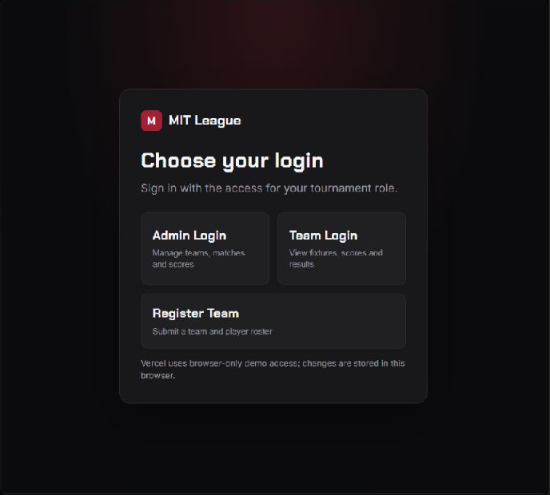
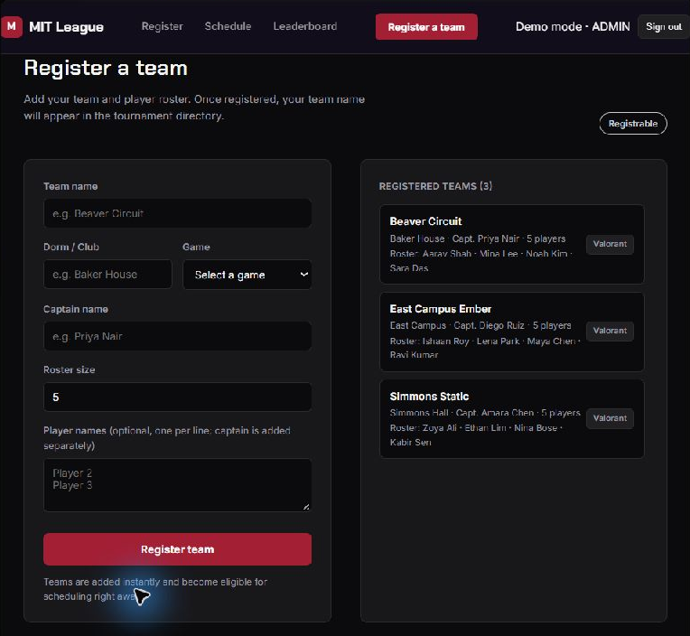
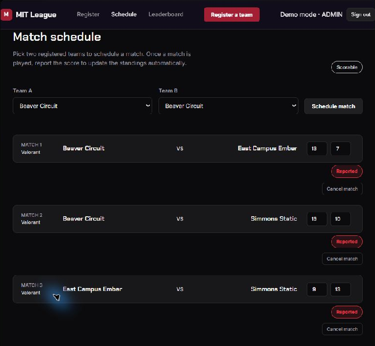
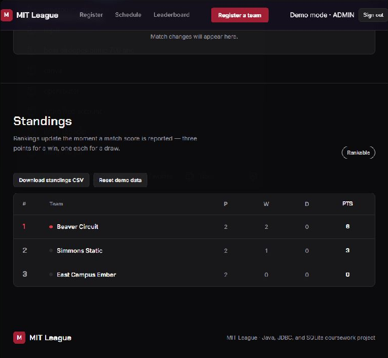
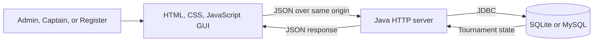
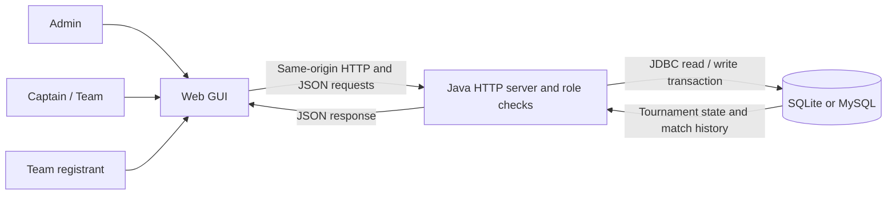
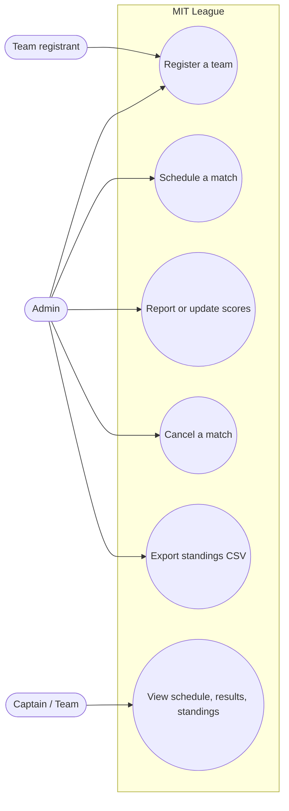

# MIT League — Esports Tournament Management

[](https://www.oracle.com/java/)
[](https://docs.oracle.com/javase/8/docs/technotes/guides/jdbc/)
[](#database)
[](https://mit-league.vercel.app)

A college esports tournament manager for team registration, match scheduling, score reporting, and live standings. The project includes a responsive browser interface and a Java HTTP server with a JDBC database backend for local coursework demonstrations.

## Problem statement

College esports events often coordinate team details, fixtures, and results through separate spreadsheets or messages. MIT League brings those tasks together in one GUI, applies role-specific access, and keeps match results and standings connected to a database in local mode.

> **Deployment note:** The Vercel site is a browser-only demo. Run the Java server locally to use SQLite or MySQL persistence and server-validated roles.

## Screenshots

These screenshots use fictional demo teams and scores.

### Role selection

Choose Admin, Team (Captain), or Register access.



### Team registration and directory

The registration view collects team details and lists registered team names.



### Admin match schedule

The Admin view shows scheduled matchups, reported scores, and match cancellation controls.



### Tournament standings

Standings are calculated from reported results and can be exported as CSV.



## Features

- Register teams with a game, college or club, captain, roster size, and optional player names.
- Schedule matches only between two different registered teams in the same game.
- Report and update scores; calculate wins, draws, and points automatically.
- Cancel scheduled or reported matches and record the action in match history.
- View recent match activity and export standings as CSV.
- Store tournament data with JDBC in SQLite by default or MySQL when configured.
- Initialize a new database from the committed schema and fictional seed data.
- Use separate role permissions in the local Java application.

## Requirements summary (SRS)

**Functional:** support Admin, Captain, and Register roles; register teams and rosters; schedule compatible matches; report or change results; cancel matches; calculate standings; and export standings to CSV.

**Non-functional:** provide a responsive GUI, a same-origin JSON API for local use, role validation in the Java service, and relational persistence through SQLite or MySQL with transactional match updates.

## Roles and permissions

| Role | Can do |
| --- | --- |
| **Admin** | Register teams, schedule matches, report or change scores, cancel matches, export standings, and reset demo data. |
| **Captain (Team Login)** | View the match schedule, scores, results, and standings. Cannot change tournament data. |
| **Register** | Submit a team registration and view registered team names. Does not see fixtures, results, or standings. |

The Java server enforces these permissions for its local demo accounts. The Vercel role flow is a client-side demonstration and is not secure authentication.

## Tools, concepts, and software

| Area | Tools |
| --- | --- |
| Web GUI | HTML, CSS, JavaScript |
| Server | Java 17+, built-in Java HTTP server |
| Persistence | JDBC, SQLite (default), optional MySQL |
| Build | Maven |
| Deployment | Vercel static hosting for the browser demo |

## Architecture



In local mode, the Java server serves the frontend and its same-origin JSON API. It validates updates and applies related database changes in a JDBC transaction. On Vercel, the static frontend runs in the browser and keeps its demo data in browser storage; no hosted database is connected.

### Data Flow Diagram (local Java mode)



### Use Case Diagram



### Local JSON API

| Method | Endpoint | Purpose |
| --- | --- | --- |
| `POST` | `/api/auth/login` | Sign in and create an in-memory demo session. |
| `POST` | `/api/auth/logout` | Revoke the current session. |
| `GET` | `/api/health` | Check server status and selected database engine. |
| `GET` | `/api/state` | Read tournament state for an authenticated role. |
| `PUT` | `/api/state` | Submit an update; the server validates it against the signed-in role. |

Editable two-page Draw.io source (DFD and use-case diagram): [Open the public source in diagrams.net](https://app.diagrams.net/?url=https%3A%2F%2Fraw.githubusercontent.com%2Fpranesh-2601%2FEsports-Tournament-Management%2Fmain%2Fdocs%2Fmit-league-diagrams.drawio) · [View the source file on GitHub](https://github.com/pranesh-2601/Esports-Tournament-Management/blob/main/docs/mit-league-diagrams.drawio)

## Quick start: Java + SQLite

### Requirements

- JDK 17 or newer
- Maven 3.9 or newer

From the repository root, run the launcher for your operating system:

```text
Windows:     run.bat
macOS/Linux: bash run.sh
```

Open [http://localhost:8080](http://localhost:8080). On the first run, the app creates `data/mit-league.sqlite`, applies the SQLite schema, and loads fictional sample teams, players, and matches. The server binds to `127.0.0.1`, so this local coursework instance is available only on the same computer. Stop it with `Ctrl+C`.

### Demo accounts

| Role | Username | Password |
| --- | --- | --- |
| Admin | `admin` | `admin123` |
| Captain | `captain` | `captain123` |
| Register | `register` | `register123` |

Set `MIT_LEAGUE_ADMIN_PASSWORD`, `MIT_LEAGUE_CAPTAIN_PASSWORD`, and `MIT_LEAGUE_REGISTER_PASSWORD` before launching to change local demo passwords. Sessions are held in memory and expire after eight hours. These credentials are intended for the loopback-only coursework app.

## MySQL configuration

Create a MySQL database and an application user with permission to create and update tables. Then set the connection variables and start the Java app:

```powershell
$env:MIT_LEAGUE_DB_URL = 'jdbc:mysql://localhost:3306/mit_league?serverTimezone=UTC'
$env:MIT_LEAGUE_DB_USER = 'mit_league_app'
$env:MIT_LEAGUE_DB_PASSWORD = 'your-local-password'
mvn compile exec:java
```

When `MIT_LEAGUE_DB_URL` is set, the application loads the MySQL schema and Connector/J driver. It seeds the sample data only if the teams table is empty. Without that variable, it uses SQLite. Keep real database credentials out of Git.

## Database

The database stores a tournament, its teams, team members, matches, and match activity. A tournament can have many teams and matches. Each team belongs to one tournament and has many players. Each match belongs to a tournament and references two participating teams. The `match_history` table records scheduling, score reporting or changes, and cancellations with a timestamp. Foreign keys maintain the relationships. Match changes and their history entries are written in one transaction so a failed update does not leave partial records. The interface reads and updates state through the local server’s `/api/state` endpoint.

| Table | Purpose |
| --- | --- |
| `tournaments` | Tournament name, season, and status. |
| `teams` | Team name, college or club, game, and roster size. |
| `players` | Captain and named roster members linked to a team. |
| `matches` | Match participants, optional scores, and result status. |
| `match_history` | Timestamped audit events for match scheduling, scores, and cancellation. |

SQLite and MySQL schemas are in `src/main/resources/db/`. `seed.sql` contains fictional starter data and is loaded only when the database has no teams. Generated local database files are ignored by Git; no database file needs to be submitted.

## Repository layout

```text
.
├── index.html                  # Web GUI and role entry flow
├── styles.css                  # Responsive interface styles
├── app.js                      # Browser UI, role views, and API client
├── src/main/java/              # Java HTTP server and JDBC application
├── src/main/resources/db/      # SQLite/MySQL schema and sample seed data
├── screenshots/                # README screenshots from the demo
├── docs/                       # Editable Draw.io DFD and use-case diagrams
├── pom.xml                     # Maven dependencies and build settings
├── run.bat                     # Windows launcher
└── run.sh                      # macOS/Linux launcher
```

## Links

- **Live demo:** [mit-league.vercel.app](https://mit-league.vercel.app)
- **GitHub repository:** [pranesh-2601/Esports-Tournament-Management](https://github.com/pranesh-2601/Esports-Tournament-Management)

Vercel serves the static frontend and deploys updates pushed to `main`. The Java server and its database are not deployed to Vercel.
